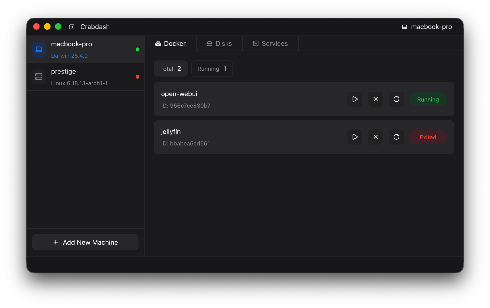

# Crabdash

A native desktop dashboard for local and SSH machines, built with Rust and [GPUI](https://www.gpui.rs/).



- Manage Docker containers, system services, disks and mounts.
- Monitor CPU, memory, network, disk and GPU activity.
- Use terminal tabs and splits without leaving the dashboard.
- Save workspaces and manage Linux, macOS and Windows machines over SSH.

## Install

Download a package from [GitHub Releases](https://github.com/th0jensen/crabdash/releases).

| Platform | Requirements |
| --- | --- |
| macOS, Apple Silicon or Intel | macOS 13+; Liquid Glass requires macOS 26 |
| Linux, ARM64 or x86-64 | glibc 2.35+, Wayland or X11, Vulkan |
| Windows, x86-64 | Windows 10 1809+, Direct3D 11; interactive device validation pending |

Packages include runtime requirements and third-party notices. macOS bundles are
ad-hoc signed, not notarized; first launch may require **Privacy & Security → Open Anyway**.
GNOME tray support requires the AppIndicator extension.

## Use

Add a machine from the sidebar; right-click a machine to rename it. Each dashboard
split has its own tabs: **+** adds a section missing from that split. Drag a tab
onto a pane edge to split, or onto a tab strip to move or reorder it.

Open the terminal with **Ctrl+J** (**⌘J** on macOS). Each terminal split has its own
**+** for a new shell. Hiding the drawer keeps sessions running. Mouse-aware programs
receive terminal mouse input; hold **Shift** to select text or scroll history.

Open Preferences with **Ctrl+,** (**⌘,** on macOS) for appearance, fonts, terminal
options and startup. Appearance defaults to the system. Liquid Glass is optional
on macOS. The default terminal type is `xterm-256color`.

## Build

Install Rust and Zig **0.16.0**, then fetch the native dependencies:

```sh
git submodule update --init --recursive
cargo run --locked
```

GPUI needs platform libraries and build tools; see [Zed's build documentation](https://zed.dev/docs/development/).
On Fedora:

```sh
sudo dnf install rust cargo zig gcc gcc-c++ clang cmake make pkgconf-pkg-config \
  alsa-lib-devel fontconfig-devel glib2-devel libva-devel wayland-devel \
  libxcb-devel libxkbcommon-x11-devel openssl-devel libzstd-devel \
  vulkan-loader mesa-vulkan-drivers sqlite-devel \
  perl-FindBin perl-IPC-Cmd perl-File-Compare perl-File-Copy git
```

On Windows, use the MSVC Rust target, Visual Studio C++ build tools and Windows SDK;
set `GPUI_FXC_PATH` to the SDK's `fxc.exe`. The [CI workflow](.github/workflows/build-release.yaml)
contains the platform build and packaging commands.

```sh
cargo build --release --locked -p crabdash
cargo test --locked --workspace --lib -- --test-threads=1
```

MIT licensed. See [LICENSE](LICENSE) and [third-party notices](THIRD-PARTY-NOTICES.txt).
